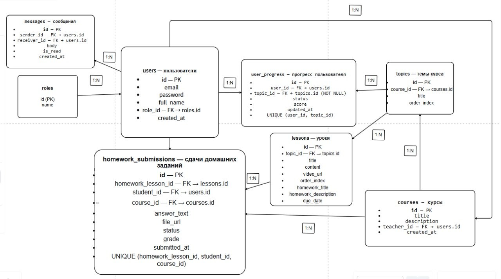

# SUNС Progress

Платформа онлайн-обучения: курсы, уроки, домашние задания, чат между студентами и преподавателями.

**Стек:** FastAPI + SQLAlchemy + PostgreSQL, фронт — React + Vite + TypeScript.

---

## Содержание

- [Что это](#что-это)
- [Стек](#стек)
- [Структура проекта](#структура-проекта)
- [Схема базы данных](#схема-базы-данных)
- [Установка и запуск](#установка-и-запуск)
- [API](#api)
- [Разработка](#разработка)

---

## Что это

SUNС Progress — учебная платформа для организации онлайн-обучения:

- **Студенты** — записываются на курсы, изучают уроки, сдают домашние задания, отслеживают прогресс.
- **Преподаватели** — создают курсы, темы, уроки, проверяют ДЗ, оставляют материалы.
- **Администраторы** — управляют пользователями и ролями.

Текущий статус — **спринт 1**: базовая инфраструктура и API авторизации.

---

## Стек

### Backend

- **Python 3.14** — managed через Python Install Manager
- **FastAPI** — веб-фреймворк
- **SQLAlchemy 2.1** — ORM
- **psycopg 3** — драйвер PostgreSQL
- **Pydantic v2** — валидация данных
- **passlib** — хеширование паролей
- **Uvicorn** — ASGI-сервер

### База данных

- **PostgreSQL 17**
- 9 таблиц: `roles`, `users`, `courses`, `topics`, `user_progress`, `lessons`, `homework_submissions`, `messages`, `materials`

### Frontend (в отдельной ветке `sunc-frontend`)

- **React 18** + **TypeScript**
- **Vite**
- **React Router**
- **Zustand**
- **Axios**

### Инструменты

- **Git** + **GitHub**
- **PyCharm**
- **pgAdmin 4** / Database tool в PyCharm
- **Kaiten** — управление задачами

---
## Структура проекта
````
sunc-backend/

├── app/                     # корневой пакет приложения
│   ├── __init__.py          # делает папку Python-пакетом
│   ├── main.py              # точка входа FastAPI, подключение роутеров
│   ├── config.py            # настройки из .env (pydantic-settings)
│   ├── database.py          # SQLAlchemy engine, SessionLocal, Base, get_db
│   │
│   ├── models/              # SQLAlchemy-модели (маппинг на таблицы БД)
│   │   ├── __init__.py      # экспорт всех моделей
│   │   ├── user.py          # User + Role
│   │   └── material.py      # Material (учебный материал)
│   │
│   ├── schemas/             # Pydantic-схемы (DTO для запросов/ответов)
│   │   ├── __init__.py
│   │   ├── user.py          # UserCreate, UserResponse
│   │   └── material.py      # MaterialCreate, MaterialResponse
│   │
│   ├── repositories/        # слой доступа к данным (в бэклоге)
│   │   └── __init__.py
│   │
│   ├── routers/             # HTTP-эндпоинты (FastAPI APIRouter)
│   │   ├── __init__.py
│   │   ├── auth.py          # POST /api/auth/register, /api/auth/login
│   │   └── materials.py     # POST/GET /api/materials
│   │
│   └── security/            # хеширование паролей, JWT (в бэклоге)
│       ├── __init__.py
│       └── utils.py         # get_password_hash, verify_password
│
├── db/
│   └── schema.sql           # SQL-скрипт создания схемы БД (9 таблиц + индексы)
│
├── docs/
│   └── images/
│       └── er-diagram.png   # ER-диаграмма базы данных
│
├── .env                     # секреты и переменные окружения (НЕ коммитится)
├── .gitignore               # исключения для Git (.venv, .env, __pycache__)
├── requirements.txt         # зависимости Python
└── README.md                # этот файл
````
---


## Схема базы данных

9 таблиц, приведены к 3-й нормальной форме.



### Связи

- `roles 1 → * users`
- `users 1 → * courses` (teacher_id)
- `users 1 → * user_progress`
- `users 1 → * homework_submissions`
- `users 1 → * materials` (teacher_id, student_id)
- `users 1 → * messages` (sender_id, receiver_id)
- `courses 1 → * topics`
- `courses 1 → * homework_submissions`
- `topics 1 → * user_progress`
- `topics 1 → * lessons`
- `lessons 1 → * homework_submissions`

### Особенности

- **Роль — отдельная сущность** через `role_id (FK → roles.id)`.
- **`user_progress`** привязан к `topic_id`, не хранит `course_id` — курс достаётся через `topics.course_id` (3НФ).
- **`homework_submissions`** фиксирует поток через `course_id` — перепоступления не смешиваются.
- Все FK с `ON DELETE CASCADE` где нужно.
- `UNIQUE`-ограничения защищают от дублей.

Полная схема — в [`db/schema.sql`](db/schema.sql).
